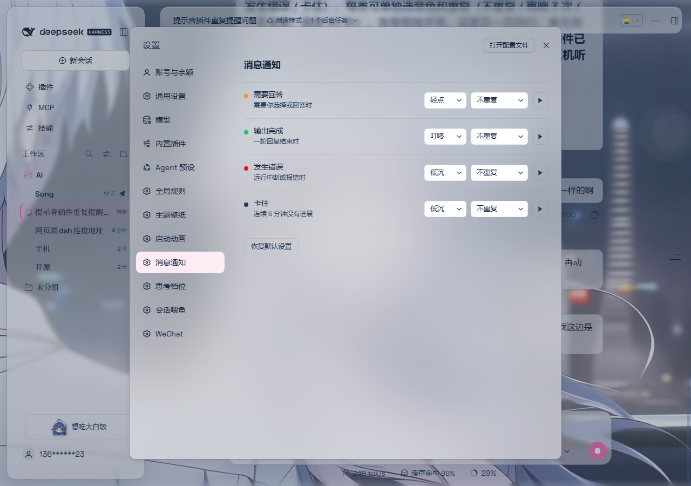

# 消息提示 · dsh-msg-notify

[English](README.en.md) | 简体中文

DSH 的提醒小工具：需要回答、输出完成、发生错误、卡住，四类场景各配一种提示音。
纯客户端插件，挂在 DSH 的设置页里；监听会话状态，到点就发声。不带外部依赖，也不用构建。

设置页截图：



- 作者：Song-812
- 版本：0.1.0
- 许可证：MIT

## 四类提醒

| 场景 | 什么时候响 | 默认音色 |
| --- | --- | --- |
| 需要回答 | 模型停下来等你选择或回答 | 轻点 |
| 输出完成 | 一轮输出正常结束 | 叮咚 |
| 发生错误 | 这一轮报错或中断 | 低沉 |
| 卡住 | 连续 5 分钟没有任何进展 | 低沉 |

每一类可以单独选音色、设置是否重复。音色：叮咚 / 低沉 / 轻点 / 静音。重复：不重复 / 再响 3 次 / 一直重复（间隔 30 秒）。没有音量滑杆；各音色有内置响度，整体仍跟随系统音量。

设置页入口：DSH「设置 → 消息提示」。每行可试听当前音色。

## 配置存在哪

配置写在浏览器的 `localStorage`，键名 `dsh-msg-notify.v1`：

- 不在 DSH 的配置文件里，也不是每个会话独立，而是**这个浏览器一份**；
- 换浏览器、清缓存、重装后要重新调；
- 文件里读不到，别指望用文本编辑器改。

## 不会误报的几条

卡住判定比较保守：

| 情况 | 会不会报「卡住」 |
| --- | --- |
| 等用户回答 / 等审批 | 否 |
| 命令还挂着、或子智能体还在跑 | 否 |
| 接不上事件流的会话（没在客户端打开过） | 否 |
| 刚打开页面时，运行中的会话 | 先安静 5 分钟再判 |

审批等待本身不响铃，但会挡住「完成」和「卡住」的误报。

## 文件结构

| 路径 | 作用 |
| --- | --- |
| `lib/index.js` | Host 半边：空壳，只为让 bundle 能按包名解析到 `main` |
| `lib/client.js` | Client 半边：检测、发声、设置页全在这里，手写、无构建 |
| `locale/` | 语言覆盖锚点 |
| `preview/settings.png` | 设置页截图 |
| `cordis.patch.yml` | 插件行声明 |
| `test/*.test.mjs` | 引擎 / 菜单 / 服务形状探测的离线测试 |

## 安装与开发

安装：在 DSH 插件面板装本目录，或 `plugin_manager install_bundle` 指向包目录。

改了 `lib/client.js` 要刷新页面；改了 `lib/index.js` 要重新启用一次插件行（或重启）。

```bash
cd msg-notify
node --test
```

`node --test` 会把 `lib/client.js` 原样加载进一个假世界（假 window / localStorage / AudioContext / 会话服务），用假时钟推进时间，断言响几声、什么时候响。测的是真实产物，不 mock 插件内部函数。

## 已知限制

- 设置只存在当前浏览器，不跟着账号或会话走。
- 没有独立音量滑杆；各音色有内置响度，整体跟随系统音量。
- 「卡住」按时间阈值判断，不会理解任务内容。
- 浏览器自动播放策略下，需先有一次页面手势才可能出声。
- 「完成 / 出错 / 卡住」依赖 DSH 客户端内部服务形状；升级若改了形状，插件会 `console.warn` 一次点名不符的服务，并静默兜底（检测可能暂时失灵）。

## 许可证

MIT，见仓库根目录 [LICENSE](../LICENSE)。© Song-812
